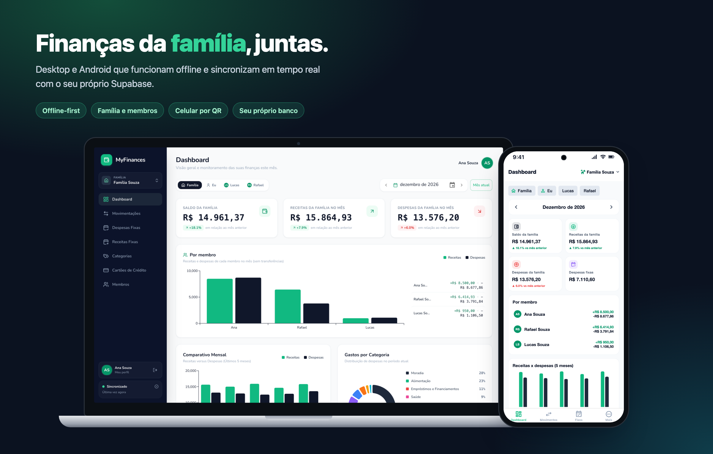
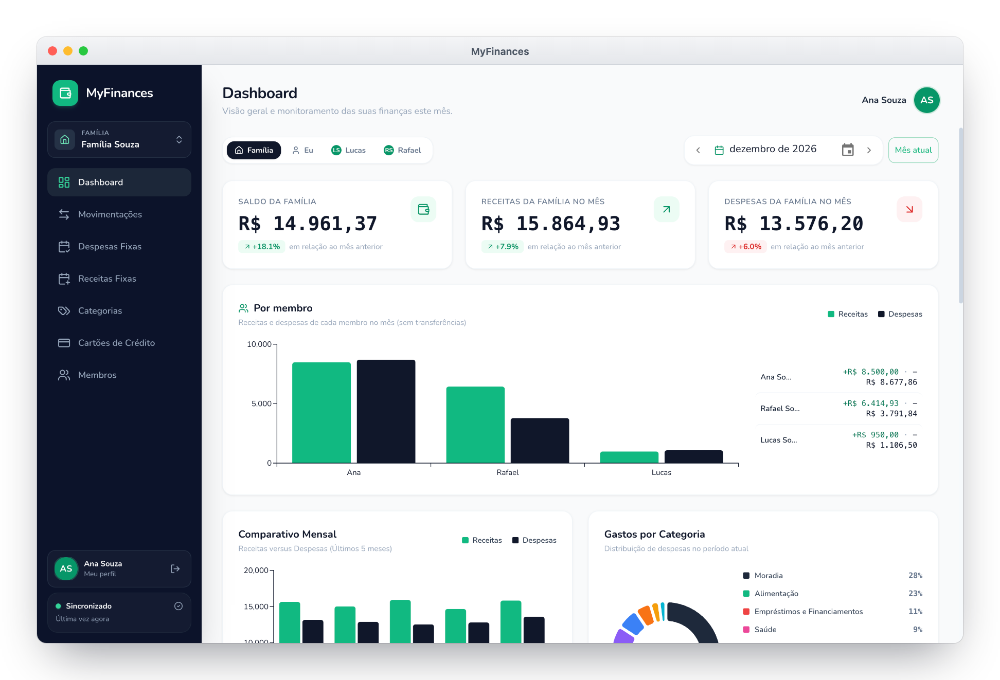
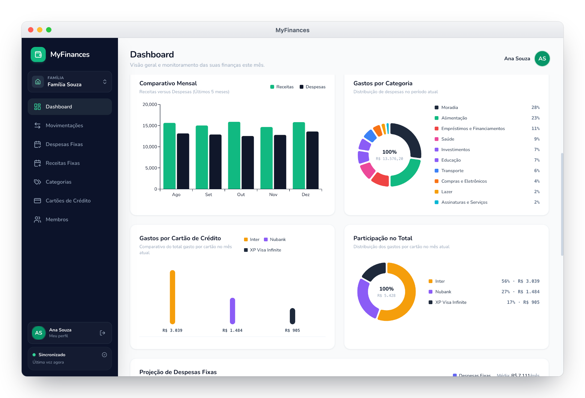
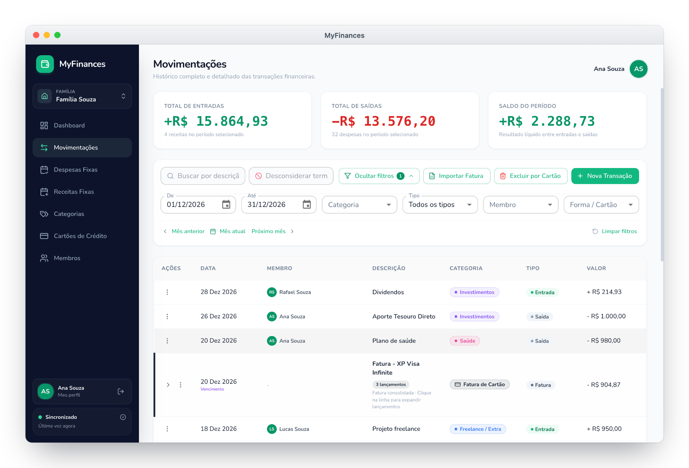
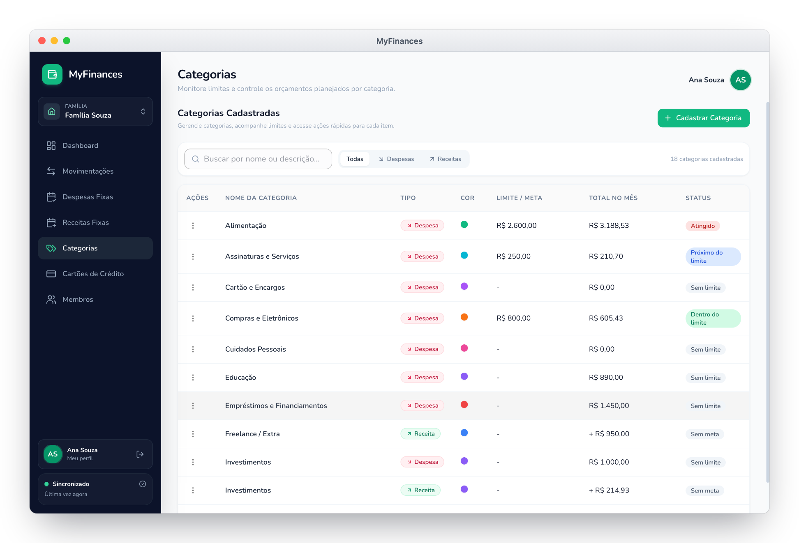
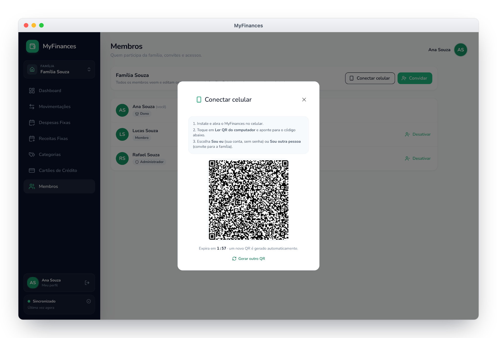
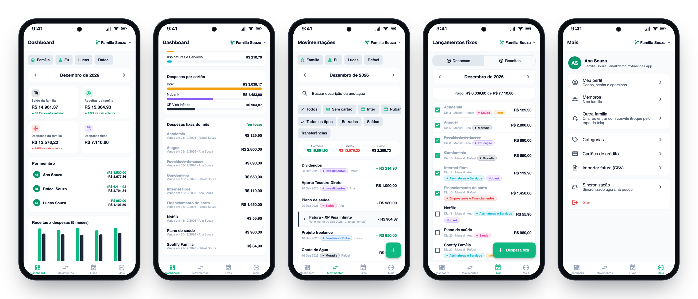

<div align="center">

# 💰 MyFinances

**Controle financeiro da família**, com apps para desktop e Android que funcionam
**offline** e sincronizam em tempo real com o **seu próprio projeto Supabase**.

[](https://github.com/jhonatanffelipe/MyFinances/releases/latest)


[**Baixar**](https://github.com/jhonatanffelipe/MyFinances/releases/latest) ·
[Guia de instalação](docs/guia-instalacao.md) ·
[Novidades](CHANGELOG.md)



</div>

## ✨ Destaques

- **Família como unidade de dados:** cada membro lança o que é seu e o dashboard soma todos,
  com visão **Família**, **Eu** ou **por membro**.
- **Funciona sem internet:** tudo é gravado no aparelho e sincroniza sozinho quando a rede
  volta; quando alguém lança algo, as outras telas atualizam na hora.
- **Seus dados, seu banco:** cada família usa o próprio projeto Supabase (plano grátis). Não
  existe servidor central.
- **Celular em segundos:** leia o QR na tela do computador e pronto, sem digitar senha.
- **Cartões e faturas:** lançamentos agrupados por fatura, importação de CSV (Nubank e Inter)
  e gastos por cartão.
- **Orçamento por categoria:** limite mensal com aviso de "próximo do limite" e "atingido".
- **Despesas e receitas fixas** com baixa mês a mês, e **transferências entre membros**
  (mesada, repasse) que não inflam os totais.

## 🖥️ Desktop (Windows e macOS)



<table>
  <tr>
    <td width="50%"></td>
    <td width="50%"></td>
  </tr>
  <tr>
    <td align="center"><sub><b>Gráficos</b> · comparativo mensal, categorias e cartões</sub></td>
    <td align="center"><sub><b>Movimentações</b> · filtros, membros e faturas agrupadas</sub></td>
  </tr>
  <tr>
    <td width="50%"></td>
    <td width="50%"></td>
  </tr>
  <tr>
    <td align="center"><sub><b>Categorias</b> · limite mensal e status do orçamento</sub></td>
    <td align="center"><sub><b>Conectar celular</b> · QR com "Sou eu" ou "Sou outra pessoa"</sub></td>
  </tr>
</table>

## 📱 Android



<p align="center"><sub>Dashboard da família · Cartões e fixos do mês · Movimentações · Lançamentos fixos · Menu</sub></p>

> As telas usam uma família de demonstração (Ana, Rafael e Lucas Souza) com dados fictícios.

## 🧱 Projetos

| Projeto | Pasta | Tecnologia |
|---|---|---|
| **Desktop (Windows e macOS)** | [`desktop/`](desktop/README.md) | Electron + React + MUI + sql.js |
| **Mobile (Android)** | [`mobile/`](mobile/README.md) | React Native (Expo) + expo-sqlite |
| **Core compartilhado** | `packages/core/` | TypeScript puro: schema local, repositórios, use cases e `SyncEngine` |
| **Banco** | `supabase/` | Migrações SQL (RLS), `setup.sql` e a Edge Function `pair-device` |

Todos os projetos usam **Yarn** (v1).

## ⚙️ Como funciona (v2)

- **Família como unidade de dados:** vários membros lançam na mesma família e o dashboard
  soma todos, com filtro por membro. Transferências entre membros não inflam os totais.
- **Offline-first:** cada aparelho lê e grava num **SQLite local**, numa pasta interna do
  app. Um sincronizador (outbox + `sync_push`/`sync_pull`) envia as alterações e traz as dos
  outros membros sempre que há internet. O Supabase Realtime avisa quando alguém lança algo.
- **Seu próprio Supabase (BYO):** o app não traz URL nem chave. Cada instalação informa a
  *Project URL* e a *Publishable key* do próprio projeto. O RLS do Postgres isola as
  famílias; a chave secreta (*service_role*) nunca entra no app.
- **Celular por QR:** no computador, *Conectar celular*; no celular, *Ler QR Code*.

A v1 (um arquivo SQLite compartilhado pelo OneDrive) continua disponível na tag `v1.0.0`.
O banco da v1 pode ser importado pela v2 (primeiro uso ou Perfil → Importar).

## 🛠️ Desenvolvimento

```bash
# Supabase local (Docker) + testes de RLS
yarn db:start
yarn db:test
yarn functions:serve        # Edge Function pair-device

# Core (regras de negócio e sincronização)
yarn core:install && yarn core:test

# Desktop
cd desktop && yarn install && yarn dev

# Mobile
cd mobile && yarn install && yarn android
```

Ao mudar qualquer arquivo em `supabase/migrations/`, rode `yarn db:bundle` para gerar de novo
o `supabase/setup.sql`.

## 📦 Versões e instaladores

Baixe os instaladores (Windows, macOS e Android) em
[Releases](https://github.com/jhonatanffelipe/MyFinances/releases). A pasta
[`versions/`](versions/README.md) guarda, por versão, o `setup.sql`, as migrações, a Edge
Function, o guia e as notas, além do passo a passo para montar uma versão nova
(`yarn build:win`, `yarn build:mac`, `yarn eas:apk` e `yarn release:assets`).
