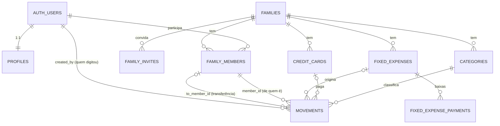

---
tags:
  - myfinances
  - plano/v2
  - moc
aliases:
  - "Plano v2.0.0"
  - "MyFinances v2"
status: em andamento
versao: 2.0.0
criado: 2026-11-07
---
# Plano: MyFinances Família + Supabase próprio (BYO)

> [!info] Status
> **Em implementação** no branch `v2.0.0` · Etapas 1 a 8 concluídas (desktop e mobile local-first; falta importar a v1 e o release) · Criado em 2026-11-07
>
> **Versões:** a versão atual (SQLite + OneDrive) é a **v1.0.0**. Este plano entrega a
**v2.0.0** (família + Supabase + funcionamento offline com SQLite local).

## Objetivo

1. **Família como unidade de dados.** Cada lançamento, categoria, cartão e despesa fixa
   pertence a uma **família**. Vários usuários entram na mesma família, e o dashboard soma
   receitas, despesas e saldo de todos, com filtro opcional por membro.
2. **Supabase no lugar do OneDrive, com funcionamento offline.** Desktop e mobile leem e
   gravam sempre num **SQLite local**, numa pasta interna do app que o usuário não escolhe.
   Um sincronizador envia as alterações ao Supabase e traz as dos outros membros sempre que
   há internet. Sem internet, tudo continua funcionando e fica na fila. Isso elimina a
   escolha de pasta, o `.lock`, os arquivos de conflito e o login Microsoft.
3. **Cada instalação usa o próprio Supabase (BYO: bring your own).** O app não traz URL nem
   chave embutidas. Na primeira execução a pessoa informa a **Project URL** e a
   **publishable/anon key** do projeto Supabase dela. Seus amigos criam a conta e o projeto
   deles. Os dados ficam no projeto de cada um, e você não tem acesso a nenhum deles.

## É possível? Sim, e o Supabase foi feito para isso

- A **anon key** (ou a nova *publishable key*, `sb_publishable_...`) **é pública por
  design**. Ela só identifica o projeto. Quem protege os dados é o **Row Level Security
  (RLS)** do Postgres, então colocá-la no app ou na config local é seguro.
- A **service_role / secret key** **nunca** entra no app. Ela ignora o RLS.
- Como cada família/amigo tem o **próprio projeto**, o isolamento entre amigos é físico
  (bancos diferentes). Dentro de um projeto, o RLS isola famílias diferentes e garante que só
  membros autenticados leem os dados.
- O binário que você distribui (o `.exe` e o `.apk`) **não contém nenhum segredo**. Se ele
  vazar, não expõe dado de ninguém.

## Decisões de arquitetura (resumo)

| Tema | Decisão | Por quê |
|---|---|---|
| Multi-tenancy | Coluna `family_id` + RLS (não schema por família) | Supabase/PostgREST trabalha com o schema `public`; o RLS é o mecanismo nativo e testável |
| IDs | `uuid` (`gen_random_uuid()`) | Sem colisão entre dispositivos e sem expor contagem |
| Dinheiro | `numeric(14,2)` (hoje é `REAL`) | Evita erro de ponto flutuante na totalização |
| Auth | Supabase Auth (e-mail + senha) | Substitui o `users.password_hash` local (scrypt); reset de senha nativo |
| Integridade entre famílias | FKs compostas `(family_id, id)` | O banco impede um lançamento da família A apontar para a categoria da família B, mesmo com bug no app |
| Fonte de leitura do app | **SQLite local** (offline-first) | Funciona sem internet e responde na hora |
| Sincronização | Sincronizador próprio: outbox + `sync_push`/`sync_pull` (RPC) | Só depende do Supabase; PowerSync exigiria um serviço extra por amigo |
| Cursor de sync | `xid8` da transação (`change_xid`) | Timestamp sofre com relógio errado; sequence "fura" com transações concorrentes |
| Exclusão | Lógica (`deleted_at`) | Dispositivos offline precisam saber o que foi apagado |
| Conflito | Último push vence, por linha, com log em `sync_conflicts` | Coerente com "todos editam tudo"; simples de explicar |
| Agregações (dashboard) | SQL no SQLite local, dentro do core | Funciona offline; `005_dashboard.sql` fica como especificação |
| Criação do schema | Script SQL idempotente colado no **SQL Editor** do Supabase | A anon key não executa DDL; pedir a senha do banco ao usuário seria tratar segredo sem necessidade |
| Versão do schema | Tabela `app_meta` + RPC `app_schema_version()` | O app avisa "rode a migração X" quando o banco estiver desatualizado |
| Convite | **Código de conexão** (URL + publishable key + token de convite, em base64url/QR) | O membro cola um código só e já entra no projeto e na família certos |
| Conectar celular | **QR no computador**: "Sou eu" (pareamento com aprovação no computador, sem senha) ou "Sou outra pessoa" (convite). Ver [[fluxo-conectar-celular\|Conectar celular por QR]] | Celular conectado e sincronizando em segundos, sem digitar URL, chave ou senha |
| Sessão do celular pareado | Sessão **própria** via Edge Function `pair-device` (`generateLink` + `verifyOtp`) | Copiar o refresh token do computador derrubaria um dos dois aparelhos; a `service_role` fica só na função |
| Código compartilhado | `packages/core` (TypeScript puro, resolvido pelo fonte via alias no Vite/Metro) com tipos, repositórios e use cases | Acaba a duplicação `desktop/electron/database/schema.ts` × `mobile/src/data/schema.ts` |
| Código compartilhado (base) | Repositórios SQL do mobile sobre `DbAdapter` sobem para o core | Já rodam em expo-sqlite e sql.js; reaproveita a v1 |
| Desktop | sql.js + `SyncEngine` + supabase-js no **processo main**, mantendo o contrato IPC | A UI quase não muda; sem módulo nativo, o build Windows a partir do Mac continua funcionando; sessão cifrada com `safeStorage` |
| Mobile | expo-sqlite + `SyncEngine` + supabase-js com sessão no `expo-secure-store` | Já são dependências do projeto |
| Permissões | Todos os membros leem **e editam** tudo da família | Decisão de produto; `created_by` fica como auditoria e não pode ser alterado |
| Cadastros | Categorias e cartões **da família** (cartão com dono opcional) | Permite somar gastos por categoria da família |
| Várias famílias | Sim, com seletor de família | O usuário pode estar na própria casa e na família dos pais, por exemplo |
| Tempo real | Supabase Realtime (`postgres_changes`, respeita RLS) | A tela atualiza quando outro membro lança |
| Transferências | `movements.type = 'TRANSFER'` com `to_member_id` | Mesada/repasse não infla receita e despesa da família |

## Modelo de dados (visão)

Cada dispositivo tem um **SQLite local** com as mesmas tabelas da família, mais
`_outbox` (alterações pendentes de envio), `_sync_state` (cursor) e `_sync_conflicts`.

O schema está em `supabase/migrations/` (fora do vault):
`001_schema` (tabelas), `002_rls` (RLS e RPCs de família), `003_sync` (sincronização),
`004_device_link` (QR / aparelhos conectados), `005_dashboard` (regra dos totais, como
referência) e `006_hardening` (permissões do anon). A Edge Function fica em
`supabase/functions/pair-device/`. O `supabase/setup.sql` é gerado por `yarn db:bundle`.

Fluxo de conexão do celular por QR: [[fluxo-conectar-celular|Conectar celular por QR]].

## Etapas

| # | Etapa | Entrega | Depende de |
|---|---|---|---|
| 1 ✅ | [[etapa-01-fundacao-supabase\|Fundação Supabase]] | Schema, RLS, RPCs, Supabase local em Docker e testes de RLS | — |
| 2 ✅ | [[etapa-02-pacote-core\|Pacote core compartilhado]] | `packages/core` com schema local, repositórios SQL (vindos do mobile) e use cases | 1 |
| 3 ✅ | [[etapa-03-sincronizacao\|Sincronização offline-first]] | Outbox, `SyncEngine`, push/pull, conflitos e testes de convergência | 2 |
| 4 ✅ | [[etapa-04-conexao-byo\|Conexão BYO (onboarding)]] | Tela "Conectar ao seu Supabase", validação e armazenamento seguro | 2 |
| 5 ✅ | [[etapa-05-auth-familias\|Autenticação e famílias]] | Cadastro/login (com uso offline), criar família, convidar, trocar de família, **conectar celular por QR** e aparelhos conectados | 3, 4 |
| 6 ✅ | [[etapa-06-desktop\|Desktop local-first]] | Handlers IPC sobre o core, indicador de sync, sem OneDrive | 5 |
| 7 ✅ | [[etapa-07-totalizacao-familia\|Totalização da família]] | Dashboard local com visão Família / por membro, transferências e tempo real | 6 |
| 8 ✅ | [[etapa-08-mobile\|Mobile local-first]] | App Android sobre o core, sem OneDrive | 5 (paralelo à 6/7) |
| 9 | [[etapa-09-migracao-dados\|Importar o banco da v1]] | **Obrigatório na v2.0.0.** Importação do `.sqlite` da v1 no primeiro uso (e pelo Perfil), no desktop e no celular | 3, 5 |
| 10 | [[etapa-10-limpeza-release\|Limpeza, release e guia]] | Remoção do OneDrive, builds v2.0.0 e guia de instalação para amigos | 7, 8, 9 |

As Etapas 3 e 4 podem andar em paralelo depois da 2. As Etapas 6–7 (desktop) e 8 (mobile)
podem andar em paralelo depois da 5.

## Riscos e limitações conhecidos

> [!warning] Leia antes de começar
> Os dois maiores riscos são a pausa do projeto gratuito e a complexidade da sincronização.

- **Plano gratuito do Supabase pausa o projeto após ~7 dias sem atividade.** O dono precisa
  reativá-lo no painel. O app precisa reconhecer esse erro e mostrar a instrução certa
  (Etapa 4). O plano gratuito também limita o número de projetos ativos por conta.
- **Confirmação de e-mail.** O SMTP padrão do Supabase tem limite baixo de envios. O guia
  (Etapa 10) orienta desligar "Confirm email" ou configurar um SMTP próprio.
- **A sincronização é a parte mais delicada do projeto** e aumenta o esforço da v2 em cerca de
  30–40%. Mitigação: o `SyncEngine` fica isolado no core, com testes de convergência entre
  dois clientes (Etapa 3) antes de qualquer tela usá-lo.
- **"Último push vence" pode surpreender.** Se duas pessoas editam o mesmo lançamento offline,
  vale a versão de quem sincronizar por último. Se uma exclui e a outra edita, a linha pode
  "voltar". Mitigação: o aviso de conflito e o histórico em `sync_conflicts`.
- **Dados ficam no dispositivo.** Quem tiver acesso ao computador ou celular desbloqueado lê o
  SQLite local. Cifrar o arquivo (SQLCipher) fica fora da v2.0.0.
- **QR sem senha depende de uma Edge Function** que cada pessoa cria no próprio Supabase
  (um passo a mais no guia). Sem ela, o app usa o fallback: o QR conecta e pede a senha
  uma vez.
- **Desconectar um aparelho não é instantâneo:** o access token já emitido vale até expirar
  (padrão 1 h).
- **Primeiro acesso exige internet** (login e carga inicial). Depois disso, o app funciona
  offline indefinidamente.
- **Todos editam tudo.** Um membro pode apagar lançamentos de outro por engano. Mitigação:
  confirmação na exclusão e `created_by` imutável para saber quem lançou.
- **Atualização de schema depende do usuário.** Cada amigo roda os scripts de migração no
  próprio projeto. O app bloqueia com mensagem clara quando a versão estiver atrás.
- **Dono do projeto Supabase vê tudo da família dele.** É o esperado: ele é o "admin" da
  própria instância.

## Decisões tomadas (2026-11-07)

| # | Tema | Decisão |
|---|---|---|
| 1 | Offline | **Offline-first na v2.0.0** nos dois apps: SQLite local automático + sincronização com o Supabase |
| 2 | Edição | Todos os membros editam e excluem qualquer lançamento da família |
| 3 | Categorias e cartões | Da família; o cartão tem dono opcional (`owner_id`) só para exibição |
| 4 | Várias famílias por usuário | Entra na v2.0.0, com seletor de família |
| 5 | Tempo real | Entra na v2.0.0 (Supabase Realtime) |
| 6 | Transferência entre membros | Entra na v2.0.0. Fica fora dos totais da família e conta como saída/entrada na visão do membro |
| 7 | Importar banco da v1 | Obrigatório na v2.0.0: oferecido no primeiro uso, logo após criar a família, e depois pelo Perfil. Desktop e celular |
| 8 | Conectar celular | QR no computador com "Sou eu" (pareamento sem senha, aprovado no computador) e "Sou outra pessoa" (convite). Sem a Edge Function, cai no login com o e-mail preenchido |

## Fora do escopo da v2.0.0

- Cifrar o SQLite local (SQLCipher).
- Merge de conflito por campo (CRDT).
- Auto-update do desktop (`electron-updater`).
