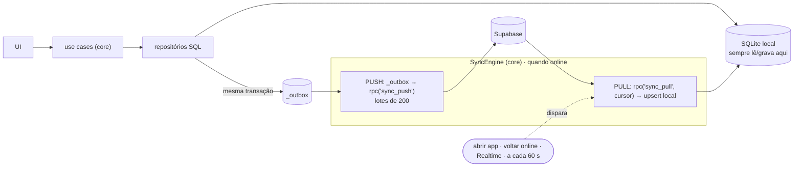

---
tags:
  - myfinances
  - plano/v2
  - etapa
aliases:
  - "Etapa 3"
  - "Sincronização offline-first"
etapa: 3
status: concluída
plano: "[[README|Plano v2.0.0]]"
depende_de:
  - "[[etapa-02-pacote-core]]"
---
# Etapa 3 — Sincronização offline-first

**Objetivo:** o app funciona 100% sem internet usando um SQLite local, e sincroniza sozinho
com o Supabase quando a conexão volta. O usuário não escolhe pasta: o arquivo fica na área
interna do app.

## Arquitetura

### Arquivo local
| Plataforma | Caminho | Engine |
|---|---|---|
| Desktop | `app.getPath('userData')/data/<projectRef>-<userId>.sqlite` | sql.js (sem módulo nativo, mantém o build Windows a partir do Mac) |
| Mobile | diretório padrão do `expo-sqlite`, mesmo nome | expo-sqlite |

Um arquivo por **projeto Supabase + usuário**: trocar de conexão ou de conta não mistura
dados. Logout pergunta se apaga a cópia local (se houver itens pendentes no outbox, avisa).

### Tabelas locais extras
- `_outbox (id, table_name, row_id, base_xid, created_at, updated_at, attempts, last_error)`: só aponta a
  linha; o conteúdo é lido da tabela na hora do push (sempre a versão mais recente)
- `_sync_state (family_id, cursor, last_pull_at, last_push_at)`
- `_sync_conflicts (...)`: espelho local para mostrar "o que foi sobrescrito"
- Todas as tabelas de domínio ganham `updated_at`, `deleted_at`, `change_xid` (texto) e
  `family_id`, espelhando o Postgres.

## Regras de sincronização

1. **IDs `uuid` gerados no cliente** (`crypto.randomUUID()` / `expo-crypto`): criar offline
   sem colisão.
2. **Escrita local + outbox na mesma transação.** Nunca existe alteração local sem pendência
   de envio.
3. **Outbox compactado:** várias edições da mesma linha antes do push viram uma só (guarda o
   payload mais recente e o `base_xid` mais antigo).
4. **Exclusão lógica** (`deleted_at`). Repositórios filtram `deleted_at IS NULL` em toda
   leitura. Excluir uma categoria mantém o `category_id` nos lançamentos, e a UI exibe "Sem
   categoria" quando a categoria está apagada (substitui o `ON DELETE SET NULL`).
5. **Ordem do push:** respeita dependências (categories → credit_cards → fixed_expenses →
   fixed_expense_payments → movements) para não violar FK no servidor.
6. **Conflito = último push vence**, por linha. O servidor grava a versão sobrescrita em
   `sync_conflicts` e devolve a lista. O app mostra um aviso discreto ("2 lançamentos foram
   alterados por outra pessoa") com acesso ao histórico.
7. **Cursor de pull = `xid8`**, não timestamp nem sequence. Explicação no cabeçalho de
   `supabase/migrations/20261107000003_sync.sql`. O upsert local é idempotente porque o pull pode
   repetir linhas.
8. **Pull não sobrescreve pendência local:** se a linha recebida tem item no outbox, o local
   prevalece até o push (senão a edição offline "voltaria" antes de subir).
9. **Erros de push:** rede = tenta de novo com backoff exponencial. Erro de validação/RLS =
   marca o item com `last_error` e segue com os demais. A tela "Pendências de sincronização"
   permite reenviar ou descartar.
10. **Carga inicial** (primeiro login em um dispositivo): pull completo paginado, com barra de
    progresso; o cursor só é salvo no fim.

## Tarefas

- [x] `003_sync.sql`: colunas de sync, trigger `sync_stamp`, `sync_push`, `sync_pull`,
  `sync_conflicts` e DELETE físico revogado.
- [x] `sync_push` devolve o `xid` da transação. O cliente grava como `change_xid` local;
  sem isso, a edição seguinte à própria sincronização acusaria conflito consigo mesma.
- [x] Log de conflito via `log_sync_conflict()` (security definer): o app não tem
  permissão de escrita em `sync_conflicts`, e o `sync_push` roda como o usuário.
- [x] Paginação do `sync_pull` (`p_limit`, `p_page` e `has_more`): keyset por
  `(change_xid, id)`, na ordem das FKs. O cursor final é fixado na primeira página.
- [x] `SyncEngine` no core (`src/sync/`), independente de plataforma. Recebe o
  `LocalStore`, um `RemoteSync` (a implementação `SupabaseRemoteSync` só precisa de
  `client.rpc`, sem depender do supabase-js em runtime), um `NetworkMonitor` e um
  `Scheduler`.
- [x] Gatilhos: escrita local (debounce de 1 s), volta da rede, `requestSync()` (para o
  Realtime) e intervalo de 60 s. Chamadas simultâneas compartilham o mesmo ciclo.
- [x] Erros: rede → backoff exponencial (2 s, 4 s, 8 s... até 5 min); recusa → o lote é
  refeito item a item, só o culpado fica com `last_error`; sem permissão → fase `error`.
- [x] Pendências: `listFailed`, `retryFailed` e `discardFailed`. Descartar remove a
  alteração local e força um pull completo para baixar a versão do servidor.
- [x] Migrações do schema local por `PRAGMA user_version` (feito na Etapa 2).
- [x] Status para a UI (`onStatus`): `idle | syncing | offline | error`, pendentes,
  recusados, último sync, último erro, conflitos do último ciclo e linhas recebidas (barra de
  progresso da carga inicial).
- [x] Casos de colisão de chave natural:
  - baixa de fixo: id determinístico de (família, fixo, mês), então dois aparelhos geram o
    mesmo id;
  - categoria com o mesmo nome criada offline nos dois aparelhos: no pull, a local é
    absorvida pela do servidor e os lançamentos são reapontados.
- [x] **Testes de integração** (`yarn core:test:sync`, 15 casos contra o Supabase local):
  carga inicial; convergência de criações offline; mesma linha editada nos dois (último
  push vence e a versão sobrescrita fica em `sync_conflicts`); sem conflito falso após o
  próprio push; exclusão × edição ressuscita a linha (esperado); tombstone; transação
  aberta no servidor durante o pull (cursor xid8); queda no meio do push (nada duplica);
  pull repetido idempotente; carga de 2.500 linhas em 3 páginas; baixa de fixo nos dois
  aparelhos; categoria duplicada; item recusado não trava os outros; membro desativado;
  Realtime entrega ao membro e não a outra família (pendência da Etapa 1).
- [x] **Testes unitários** (`yarn core:test`, +5): offline, confirmação do push, backoff,
  debounce e volta da rede, ciclo único.
- [ ] `NetworkMonitor` de cada plataforma (desktop: `navigator.onLine` + ping; mobile:
  netinfo) → Etapas 6 e 8.
- [ ] Gravação atômica do arquivo do sql.js (tmp + rename, debounce, flush no
  `before-quit`) → Etapa 6, junto com o `SqlJsFileAdapter` do desktop.
- [ ] Tela "Pendências de sincronização" e aviso de conflito → Etapas 6 e 8 (a API já existe).

## Comportamentos que a UI precisa explicar

- **Exclusão × edição:** se uma pessoa exclui e outra edita a mesma linha offline, vence
  quem sincronizar por último. Se a edição subir depois, o lançamento volta.
- **Categoria duplicada offline:** a do aparelho que sincronizou depois some, e os
  lançamentos dela passam para a categoria igual que já estava no servidor.
- **Logo após `supabase db reset`**, o Realtime local leva alguns segundos para voltar. O
  intervalo de 60 s cobre a falta de eventos em produção.

## Fora do escopo

- Merge por campo (CRDT). A regra por linha basta para o uso familiar.
- Sincronização de anexos/arquivos.

## Pronto quando

- Dá para usar o app em modo avião por dias, voltar a internet e ver os dados aparecerem no
  outro dispositivo sem ação manual.
- Todos os testes de convergência acima passam.

---

[[etapa-02-pacote-core|← Etapa 2]] · [[README|Plano v2.0.0]] · [[etapa-04-conexao-byo|Etapa 4 →]]
