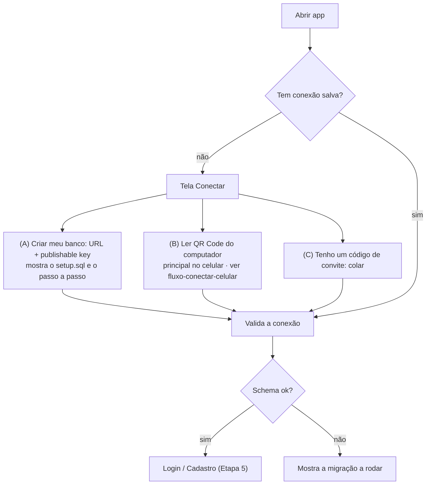

---
tags:
  - myfinances
  - plano/v2
  - etapa
aliases:
  - "Etapa 4"
  - "Conexão BYO"
etapa: 4
status: pendente
plano: "[[README|Plano v2.0.0]]"
depende_de:
  - "[[etapa-02-pacote-core]]"
---
# Etapa 4 — Conexão com o Supabase de cada usuário (BYO)

**Objetivo:** na primeira execução, o app pede o projeto Supabase da pessoa, valida e
guarda com segurança. Essa tela substitui a atual `desktop/src/pages/db-setup` (escolha da
pasta do OneDrive) e as telas `mobile/src/app/sync.tsx` e `login.tsx` (login Microsoft).

## Fluxo

## Tarefas

- [ ] Tela **Conectar** com dois caminhos:
  - **Criar meu banco (dono):** campos `Project URL` e `Publishable key`, com link "onde acho
    isso?" (Supabase → Project Settings → API) e botão "Copiar script de instalação"
    (`setup.sql` da release).
  - **Ler QR Code** (celular, ação principal): lê o QR de "Conectar celular" do computador e
    segue o [[fluxo-conectar-celular|fluxo de conexão do celular]].
  - **Entrar com código de convite (membro):** um campo para colar o código.
- [ ] **Código de conexão** (mesmo formato no QR e no texto colado): `mf1.` + base64url de JSON
  `{ v, url, key, family, by, pair, invite }`, especificado no
  [[fluxo-conectar-celular#Conteúdo do QR|fluxo de conexão do celular]].
  - Valida que `url` é `https://<ref>.supabase.co` (ou domínio custom com `https`) e que a
    key **não** é secret/service_role. Rejeita `sb_secret_...` e JWT com
    `role = service_role`, mostrando um alerta explicando o risco.
- [ ] **Validação ao salvar** (em ordem, cada falha com mensagem própria):
  1. URL acessível (erro de rede ≠ URL errada);
  2. key aceita pelo projeto;
  3. projeto **pausado** (plano free): mensagem "reative em supabase.com/dashboard";
  4. `rpc('app_schema_version')` inexistente: "rode o script de instalação";
  5. versão < `MIN_SCHEMA_VERSION`: "rode as migrações X..Y".
- [ ] **Armazenamento:**
  - Desktop: config em `userData` (substitui `dbFolder`/`dbFilePath` de
    `desktop/electron/config.ts`). Sessão e refresh token cifrados com `safeStorage` do
    Electron, via `storage` customizado do supabase-js no processo main.
  - Mobile: `expo-secure-store` para URL, key e sessão.
- [ ] Em **Perfil → Conexão**: ver o projeto conectado, testar, trocar (com logout) e
  "esquecer este banco".
- [ ] Nenhuma URL ou key de exemplo real no código nem nos testes (usar o stack local).

## Pronto quando

- Conectar num projeto novo (vazio), num projeto com schema e num projeto pausado leva às
  três mensagens corretas.
- Fechar e reabrir o app mantém a conexão sem pedir de novo.

---

[[etapa-03-sincronizacao|← Etapa 3]] · [[README|Plano v2.0.0]] · [[etapa-05-auth-familias|Etapa 5 →]]
