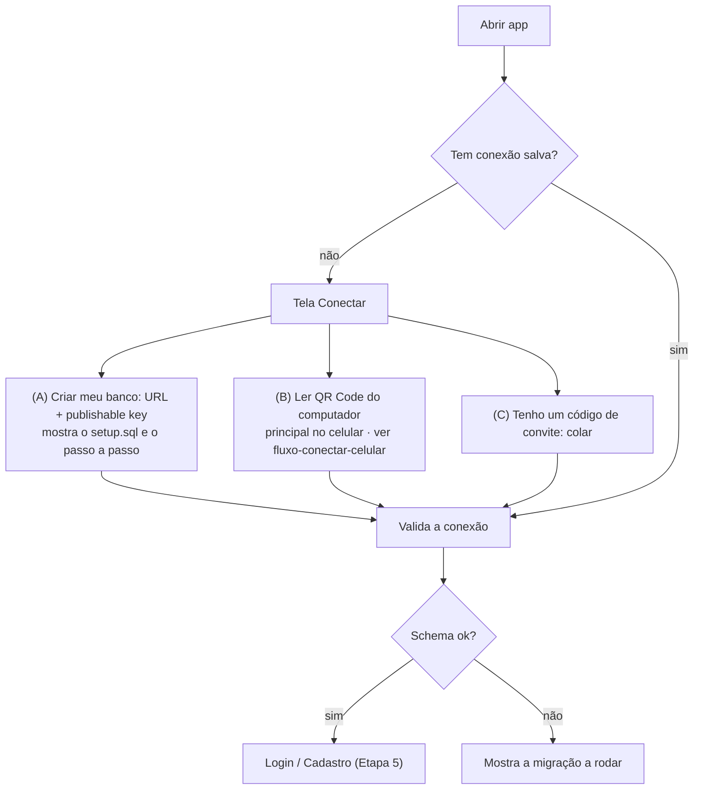

---
tags:
  - myfinances
  - plano/v2
  - etapa
aliases:
  - "Etapa 4"
  - "Conexão BYO"
etapa: 4
status: concluída
plano: "[[README|Plano v2.0.0]]"
depende_de:
  - "[[etapa-02-pacote-core]]"
---
# Etapa 4 — Conexão com o Supabase de cada usuário (BYO)

**Objetivo:** na primeira execução, o app pede o projeto Supabase da pessoa, valida e
guarda com segurança. Essa tela substitui a atual `desktop/src/pages/db-setup` (escolha da
pasta do OneDrive) e as telas `mobile/src/app/sync.tsx` e `login.tsx` (login Microsoft).

## Fluxo

## Divisão do trabalho

As telas dependem de os apps já rodarem sobre o core, e isso só acontece nas Etapas 6
(desktop) e 8 (mobile). Por isso esta etapa entrega a **lógica e o armazenamento**, testados
contra o Supabase local, e as telas entram junto com a troca de cada app:

| Peça | Onde | Status |
|---|---|---|
| Verificação da conexão (`checkConnection`) | `packages/core/src/connection/checkConnection.ts` | ✅ |
| Código `mf1.` (QR e convite), recusa da chave secreta | `packages/core/src/connection/connection.ts` (Etapa 2) | ✅ |
| Conexão salva (`ConnectionRepository`), nome do banco local | `packages/core/src/connection/storage.ts` | ✅ |
| Store cifrado do desktop (`safeStorage`, gravação atômica) | `desktop/electron/connection/secureStore.ts` | ✅ |
| Store seguro do mobile (`expo-secure-store` em pedaços de 1,8 KB) | `mobile/src/connection/secureStore.ts` | ✅ |
| Tela Conectar e Perfil → Conexão no desktop | Etapa 6 | pendente |
| Tela Conectar (com Ler QR Code) e Perfil → Conexão no mobile | Etapa 8 | pendente |

## Tarefas

- [x] **Validação ao salvar**, em ordem, cada falha com o próprio código de `AppError`:
  1. formato da URL e da chave: a secreta (`sb_secret_...` ou JWT `service_role`) é
     recusada **antes de qualquer acesso à rede** (`SECRET_KEY_REJECTED`);
  2. projeto inacessível: com internet → `INVALID_CONNECTION` (`reason: unreachable`), sem
     internet → `OFFLINE` (sonda em `api.supabase.com`);
  3. chave recusada pelo projeto (401/403/PGRST301) → `INVALID_CONNECTION` (`reason: key`);
  4. projeto pausado (HTTP 540 ou mensagem com "paused"/"restore") → `PROJECT_PAUSED`;
  5. `app_schema_version` inexistente (PGRST202) → `SCHEMA_MISSING`;
  6. versão < `MIN_SCHEMA_VERSION` → `SCHEMA_OUTDATED`;
  7. 5xx → `OFFLINE`; resposta que não é número → `INVALID_CONNECTION` (`reason: not_supabase`).
- [x] **Armazenamento:** `KeyValueStore` no formato do `storage` do supabase-js, então o
  mesmo store guarda a conexão **e** a sessão (refresh token).
  - Desktop: JSON em `userData/secure-store.json` com cada valor cifrado pelo
    `safeStorage`; recusa gravar se a criptografia do sistema estiver indisponível.
  - Mobile: `expo-secure-store`, com valores grandes divididos em pedaços (o limite é
    ~2 KB e a sessão passa disso). O contador de pedaços é gravado por último, então uma
    gravação interrompida não é lida pela metade.
  - A conexão salva é revalidada ao carregar: conteúdo inválido ou chave secreta são
    descartados.
- [x] Banco local: `localDatabaseName(url, userId)` → `<projectRef>-<userId>.sqlite`.
- [x] Nenhuma URL ou chave real no código: os testes usam o stack local
  (`supabase status`).
- [x] Testes: 12 unitários (`fetch` falso cobrindo cada ramo) e 4 de integração (projeto
  local com publishable key e anon JWT, JWT com assinatura falsa, porta fechada com e sem
  internet, sessão do supabase-js que sobrevive a "fechar e reabrir").
- [ ] Telas → Etapas 6 e 8 (ver a tabela acima).

## A validar quando houver um projeto pausado

- A resposta exata do Supabase para projeto pausado. O código aceita HTTP 540 e mensagens
  com "paused"/"restore". Na primeira vez que um projeto de teste pausar, chamar
  `checkConnection` contra ele e conferir o código e a mensagem.
- Localmente, uma publishable key inválida é aceita (o gateway local não valida esse
  formato). Na nuvem a resposta é 401, e o código já trata esse caso.

## Pronto quando

- Conectar num projeto novo (vazio), num projeto com schema e num projeto pausado leva às
  três mensagens corretas.
- Fechar e reabrir o app mantém a conexão sem pedir de novo.

---

[[etapa-03-sincronizacao|← Etapa 3]] · [[README|Plano v2.0.0]] · [[etapa-05-auth-familias|Etapa 5 →]]
