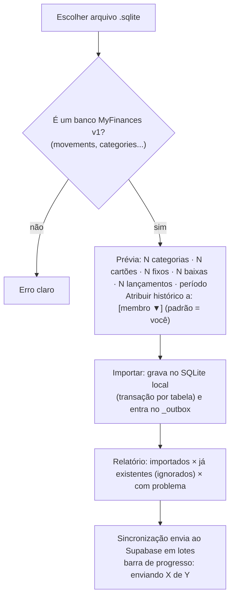

---
tags:
  - myfinances
  - plano/v2
  - etapa
aliases:
  - "Etapa 9"
  - "Importar o banco da v1"
etapa: 9
status: concluída
plano: "[[README|Plano v2.0.0]]"
depende_de:
  - "[[etapa-03-sincronizacao]]"
  - "[[etapa-05-auth-familias]]"
---
# Etapa 9 — Importar o banco da v1 (migração direta)

**Objetivo:** na v2.0.0, quem já usa a v1 escolhe o próprio `db_myfinances.sqlite` e o app
migra tudo para a família, logo no primeiro uso, num passo só. Nada de script manual,
exportar CSV ou rodar SQL.

> [!important] Obrigatório na v2.0.0
> A release não sai sem esta etapa.

## Onde aparece

1. **No primeiro uso (onboarding):** logo depois de criar a família (Etapa 5), uma tela
   pergunta: **"Você já usa o MyFinances v1? Importar meu banco"** ou **"Começar do zero"**.
   É o caminho principal.
2. **Depois, a qualquer momento:** Perfil → **Importar banco da v1** (OWNER/ADMIN), para quem
   pulou o passo ou quer importar o banco de outra pessoa da família.

Funciona no **desktop e no celular**. Como a importação usa os repositórios do core, as duas
plataformas compartilham a mesma lógica: o desktop abre o arquivo com sql.js, e o celular
escolhe o arquivo pelo `expo-document-picker` (já é dependência), copia para a pasta do app e
abre com expo-sqlite.

## Fluxo

Funciona **offline**: os dados entram no banco local na hora e sobem quando houver internet.

## Regras de migração

- **Leitura tolerante ao schema da v1.** Bancos antigos podem não ter colunas que a v1 adicionou
  com o tempo pelo `ensureColumn` (`credit_card_id`, `fixed_expense_id`, `recurrence`, `type`
  dos fixos, `monthly_limit`, `description` da categoria). O importador consulta
  `PRAGMA table_info` e usa os padrões da v1 quando a coluna falta.
- **Somente leitura no arquivo original.** O arquivo escolhido nunca é alterado: o app abre uma
  cópia.
- Mapeamento:
  - `INTEGER id` → `uuid` novo, com um de-para em memória para remontar as FKs (categoria,
    cartão e fixo dos lançamentos; fixo das baixas);
  - `REAL amount` → arredondado a 2 casas;
  - `active 0/1` → boolean;
  - `fixed_expenses.type` vazio → `EXPENSE` (mesma normalização que a v1 já faz);
  - FKs órfãs (ex.: lançamento apontando para categoria apagada) → `null`, contadas no
    relatório como "com problema";
  - **`member_id` de todos os registros = membro escolhido**, porque a v1 não registra quem
    lançou.
- **Categorias e cartões com o mesmo nome já existentes na família são reaproveitados**, sem
  duplicar. Isso permite importar o banco de um segundo membro na mesma família.
- **Idempotente:** `import_hash = 'v1:<tabela>:<hash do arquivo>:<id antigo>'`. Importar o
  mesmo arquivo duas vezes não duplica nada, nem no local nem no servidor (índice único
  `(family_id, import_hash)`).
- Usuários da tabela `users` da v1 **não** são migrados: cada pessoa cria a conta no Supabase
  Auth e entra por convite.

## Tarefas

- [x] `ImportV1Database` (use case no core): validar → prévia → importar → relatório,
  recebendo um `DbAdapter` aberto sobre o arquivo da v1.
- [x] Tela de importação no onboarding e no Perfil, nos dois apps.
- [x] Barra de progresso da gravação local e do envio (status do `SyncEngine`).
- [x] Testes com fixtures: um banco v1 "antigo" (sem as colunas adicionadas depois), um banco v1
  atual e um banco com FKs órfãs. Conferir que os totais por mês da v1 batem com os da v2 e
  que reimportar não duplica nada.

## Como ficou (2026-11-07)

- **Core:** `core.importV1.preview` e `core.importV1.execute` (`use-cases/importV1.ts`),
  recebendo um `DbAdapter` sobre uma CÓPIA do arquivo (desktop: sql.js em memória; celular:
  `deserializeDatabaseAsync`). Só OWNER/ADMIN importam; o histórico vai para o membro escolhido.
- **Idempotência (ajuste ao schema real):** só `movements` tem `import_hash`. Categorias e
  cartões são reaproveitados pelo nome; fixos ganham id determinístico
  (`família + identidade do banco v1 + id antigo`, repositório aceita id explícito); baixas
  usam o `setPaid` idempotente. A "identidade" vem das linhas mais antigas do banco (primeiro
  usuário, categoria e lançamento), não do hash do arquivo: assim, importar uma cópia MAIS
  NOVA do mesmo banco traz só o que é novo. O que a família excluiu depois não volta.
- **Fixos da v1** são gravados pelo repositório, sem regerar lançamentos: os lançamentos que a
  v1 gerou vêm do arquivo, com `fixed_expense_id` remontado.
- **Onboarding:** o `AppSession` expõe `offerV1Import` logo após criar a família (tela
  "Você já usa o MyFinances v1?"); some em "Começar do zero" ou no "Ir para o app" do relatório.
  No Perfil, card "Banco da v1" (OWNER/ADMIN), no desktop e no celular.
- **Verificado:** 10 testes com fixtures (banco v1 antigo e atual, FKs órfãs, reimportação,
  cópia mais nova, excluídos não voltam, segundo membro, permissões, arquivo intacto);
  integração com 3 mil lançamentos em 24 meses (envio em ~1,7 s; o celular de outro membro vê
  os mesmos totais da v1 em todos os meses); E2E no app desktop pelo onboarding.
- **Não verificado em aparelho:** a escolha do arquivo e o `deserializeDatabaseAsync` no
  celular (sem Android nesta máquina).

## Pronto quando

- Você instala a v2.0.0, cria a conta e a família, escolhe o seu `db_myfinances.sqlite` atual,
  e o dashboard "Família" mostra os mesmos totais que a v1 no mesmo mês, também no celular
  depois da sincronização.
- Importar o mesmo arquivo de novo não duplica nada.

---

[[etapa-08-mobile|← Etapa 8]] · [[README|Plano v2.0.0]] · [[etapa-10-limpeza-release|Etapa 10 →]]
