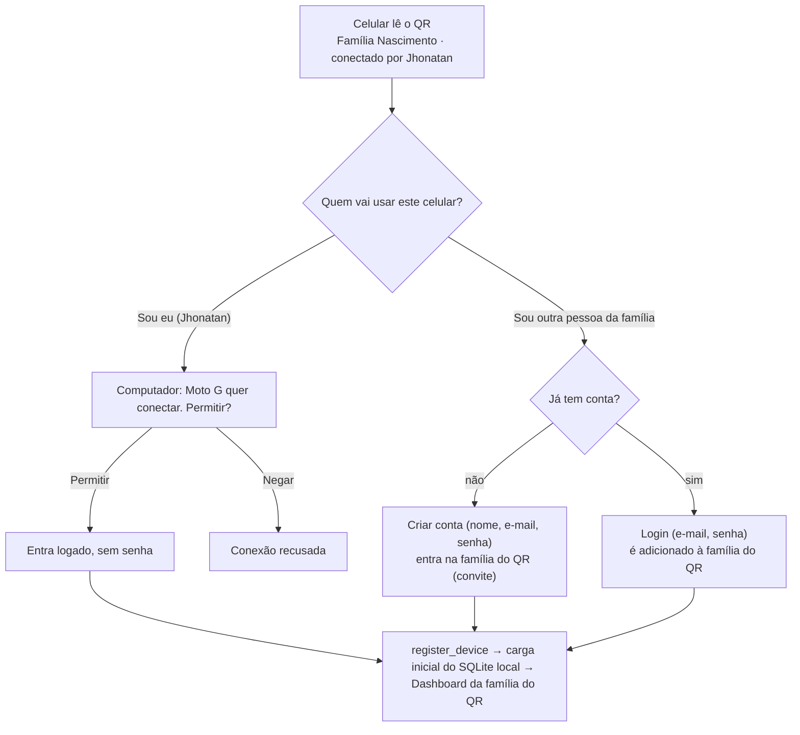
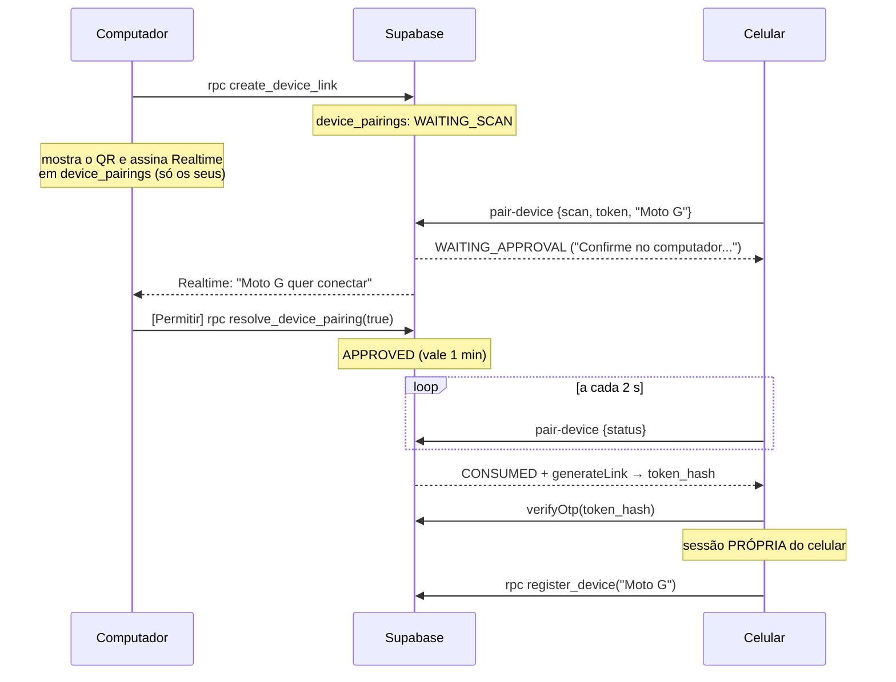

---
tags:
  - myfinances
  - plano/v2
  - fluxo
aliases:
  - "Conectar celular por QR"
  - "Fluxo do QR"
status: pendente
plano: "[[README|Plano v2.0.0]]"
etapas:
  - "[[etapa-04-conexao-byo]]"
  - "[[etapa-05-auth-familias]]"
  - "[[etapa-06-desktop]]"
  - "[[etapa-08-mobile]]"
---
# Fluxo: conectar o celular por QR Code

> [!abstract] Especificação transversal
> É implementada nas Etapas [[etapa-04-conexao-byo|4]]
> (formato do QR), [[etapa-05-auth-familias|5]] (backend e regras),
> [[etapa-06-desktop|6]] (tela no computador) e [[etapa-08-mobile|8]] (leitura no
> celular). Rascunhos: [[sql/005_device_link.sql|sql/005_device_link.sql]] e
> [[functions/pair-device/index.ts|functions/pair-device/index.ts]].

## Objetivo

Abrir o app no celular, ler um QR na tela do computador e já estar conectado, logado e
sincronizando, **sem digitar URL, chave nem senha**. O mesmo QR serve para outra pessoa da
família criar a conta dela e entrar na família.

## Experiência

**No computador:** Perfil → **Conectar celular** (também no menu do seletor de família).

```
┌─────────────────────────────────────────────┐
│  Conectar celular · Família Nascimento        │
│                                               │
│            ███ QR CODE ███                    │
│                                               │
│  Abra o MyFinances no celular e toque em      │
│  "Ler QR Code".            Expira em 1:47 ⟳   │
└─────────────────────────────────────────────┘
```

**No celular**, a primeira tela tem **Ler QR Code** como ação principal e "Conectar
manualmente" como alternativa.



- **"Sou eu"** = **pareamento**: mesma conta, aparelho novo. Não pede família nem usuário.
  Abre na família do QR, e o seletor continua disponível para trocar.
- **"Sou outra pessoa"** = **convite**: só aparece se quem gerou o QR é OWNER/ADMIN. Se não
  for, o QR mostra apenas "Sou eu".
- O celular **nunca lista famílias** antes de alguém se identificar. A família sempre vem
  do QR, que só um membro consegue gerar.

## Conteúdo do QR

`mf1.` + base64url de:

```json
{
  "v": 1,
  "url": "https://<ref>.supabase.co",
  "key": "sb_publishable_...",
  "family": { "id": "<uuid>", "name": "Família Nascimento" },
  "by": { "name": "Jhonatan", "email": "jhonatan@..." },
  "pair": "<token de pareamento>",
  "invite": "<token de convite ou null>"
}
```

- `url` e `key` são públicas por design. A `service_role` nunca aparece.
- `by.email` só serve para preencher o login no fallback (ver abaixo).
- `pair`: 256 bits, uso único, **expira em 2 minutos**, e no banco fica só o hash. Gerar um QR
  novo invalida o anterior.
- `invite`: uso único, **expira em 10 minutos**, e no banco fica só o hash.
- O QR é regenerado automaticamente quando expira, enquanto a tela estiver aberta.

## Sequência do pareamento ("Sou eu")



Por que não copiar a sessão do computador: o Supabase troca o refresh token a cada uso. Dois
aparelhos com o mesmo token acabariam derrubando um ao outro.

## Fallback sem a Edge Function

O celular chama `pair-device {ping}` ao ler o QR. Se a função não existir (404):

- **"Sou eu"** vira a tela de login com o e-mail já preenchido (`by.email`): só digitar a
  senha.
- **"Sou outra pessoa"** não muda, porque o convite é uma RPC SQL e não depende da função.

Nada trava, e o guia de instalação explica como criar a função para a experiência completa.

## Segurança

| Ameaça | Proteção |
|---|---|
| Alguém fotografa o QR na tela | O pareamento exige **Permitir** no computador, mostrando o nome do aparelho; o QR vale 2 min e é de uso único |
| Dois celulares leem o mesmo QR | O `scan` é um UPDATE condicional atômico: só o primeiro passa, o segundo recebe "expirado" |
| Adivinhar o token | 256 bits aleatórios; o banco guarda só o sha256 |
| Vazamento da `service_role` | Existe só como variável de ambiente da Edge Function |
| Celular perdido | Perfil → **Aparelhos conectados** → Desconectar (`revoke_device` apaga a sessão no Auth; o celular perde o acesso em até 1 h, quando o access token expira) |
| Convite capturado | Uso único, 10 min; o novo membro aparece na lista de membros e pode ser desativado pelo OWNER/ADMIN |

## Estados e mensagens no celular

| Estado | Mensagem |
|---|---|
| `WAITING_APPROVAL` | "Confirme no computador para continuar" (com spinner) |
| `DENIED` | "Conexão recusada no computador." |
| `EXPIRED` | "Este QR expirou. Gere um novo no computador." |
| `CONSUMED` (lido por outro aparelho) | "Este QR já foi usado." |
| Sem internet | "Conecte-se à internet para o primeiro acesso." |

---

[[README|Plano v2.0.0]]
